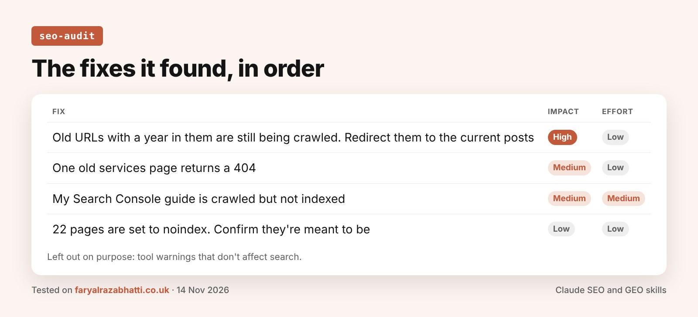
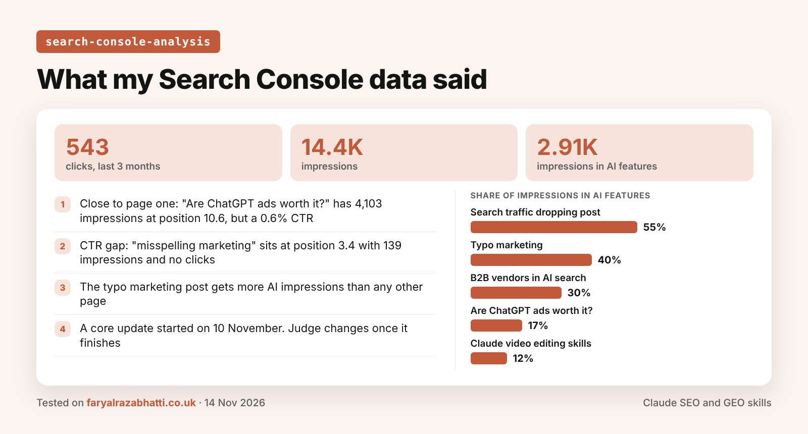
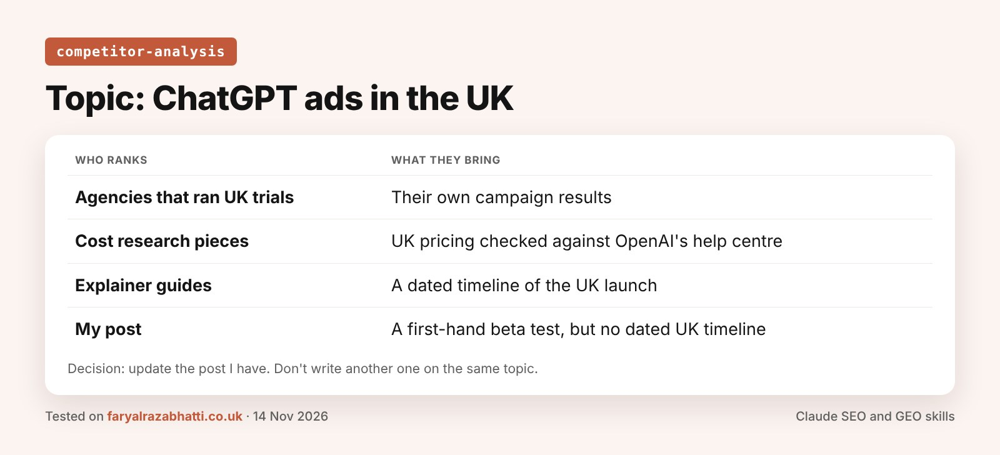
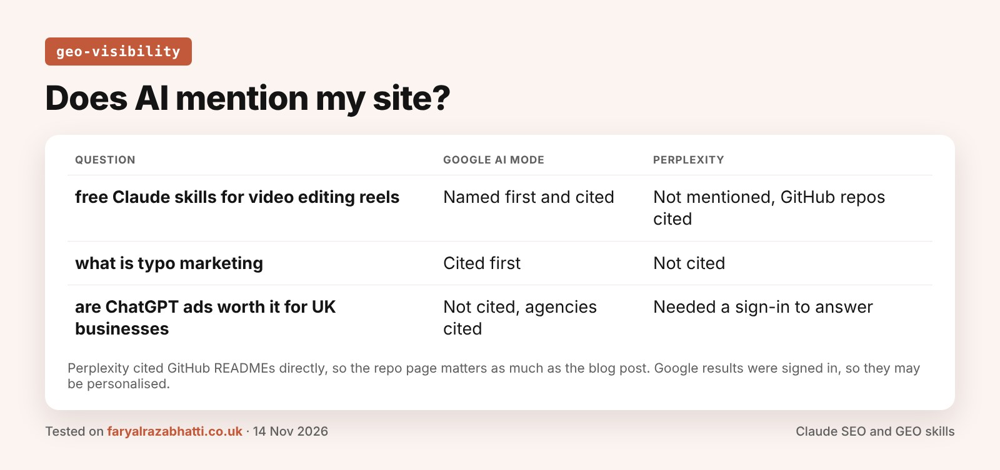
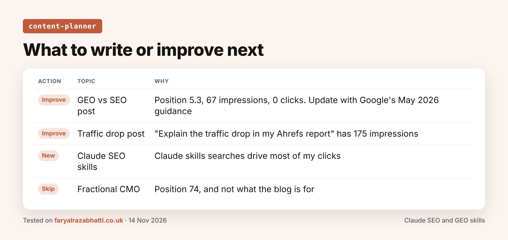
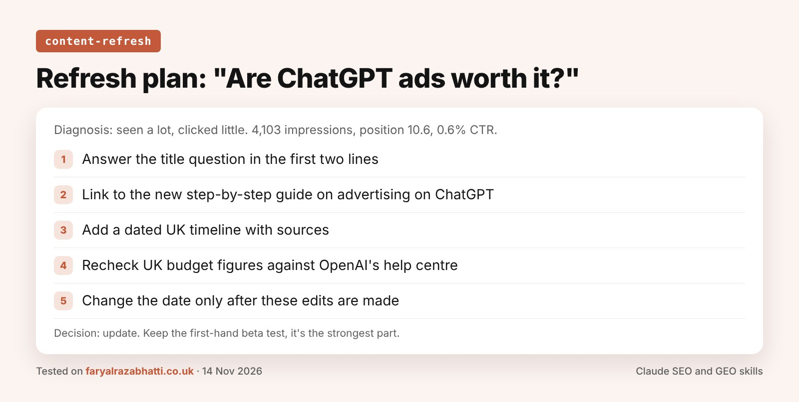
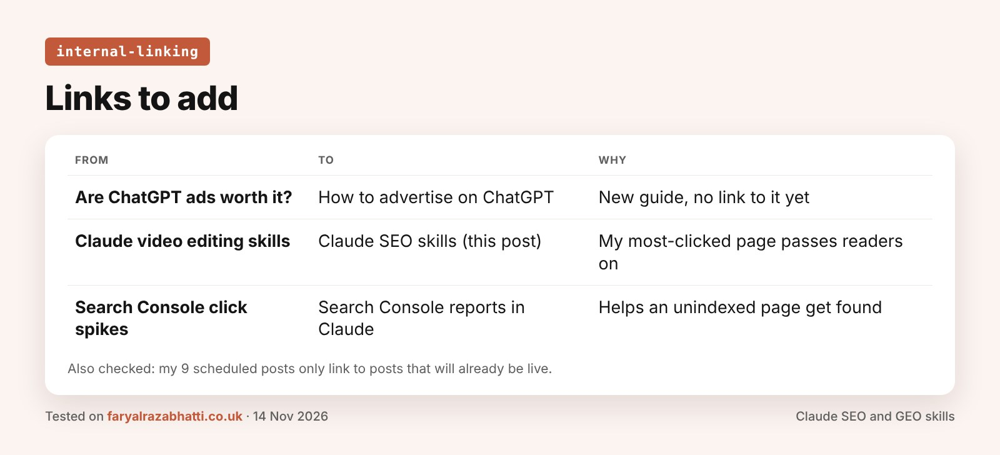
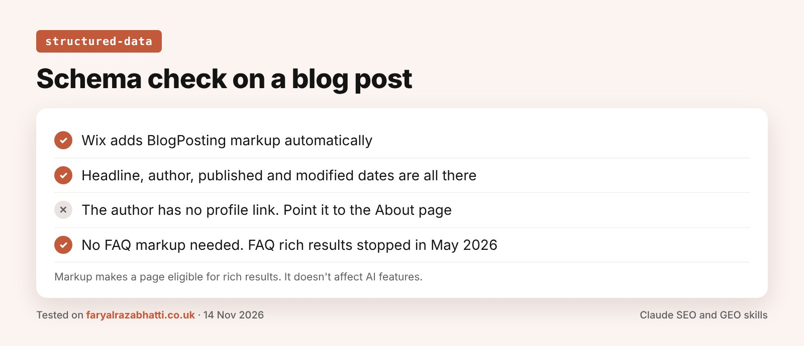
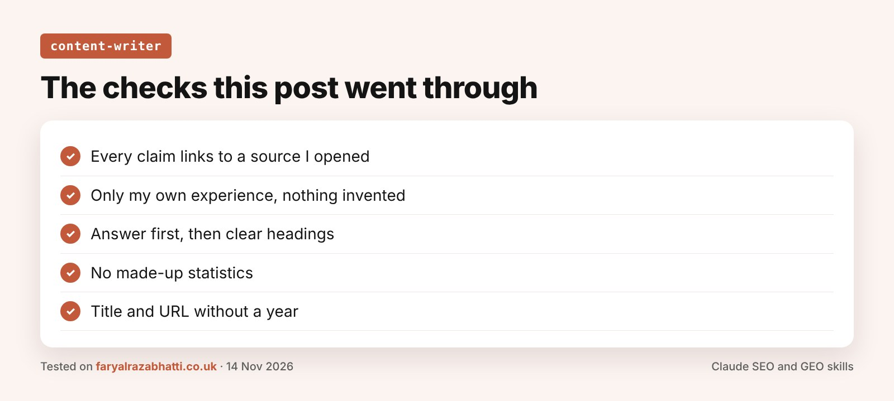
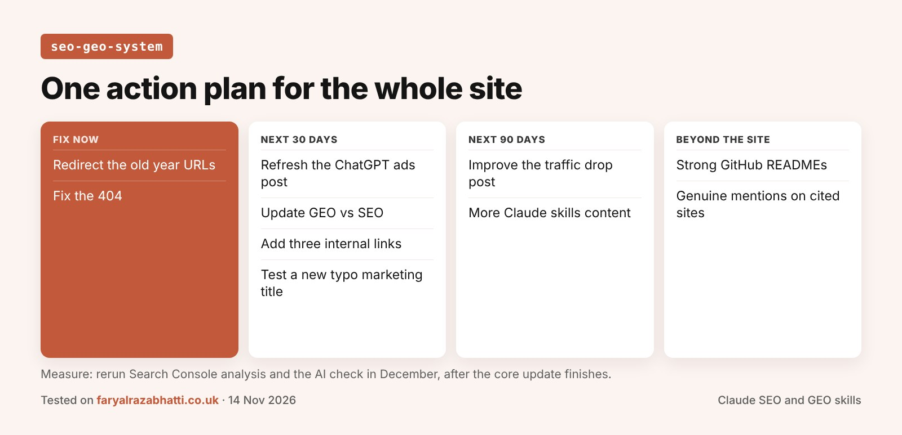

# Example: all ten skills run on faryalrazabhatti.co.uk

A real test run on 14 November 2026, using the site's own Google Search Console data (the last three months), its live pages, and answers from Google AI Mode and Perplexity.

The full write-up, with what each skill found, is on the blog: [Claude SEO skills: free downloads, tested on my own site](https://www.faryalrazabhatti.co.uk/post/claude-seo-skills-free-download).

## Results

| Skill | Result |
|---|---|
| `seo-audit` |  |
| `search-console-analysis` |  |
| `competitor-analysis` |  |
| `geo-visibility` |  |
| `content-planner` |  |
| `content-refresh` |  |
| `internal-linking` |  |
| `structured-data` |  |
| `content-writer` |  |
| `seo-geo-system` |  |

## Source screenshots

- Search Console performance: `images/gsc-performance.jpg`
- Search Console Generative AI report: `images/gsc-generative-ai.jpg`
- Search Console page indexing: `images/gsc-page-indexing.jpg`
- Google AI Mode answers: `images/ai-mode-claude-video-skills.jpg`, `images/ai-mode-typo-marketing.jpg`

Google AI Mode was checked while signed in, so its answers may be personalised.
